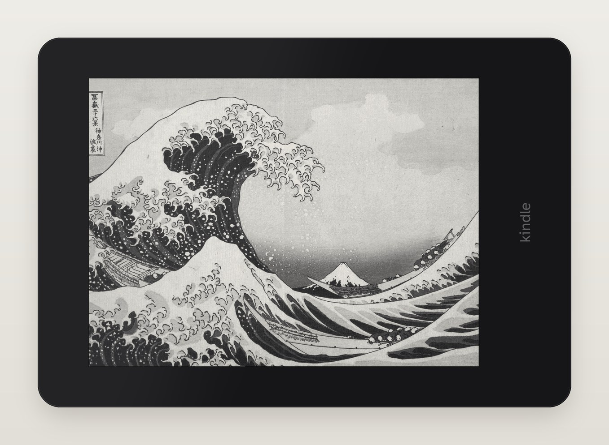
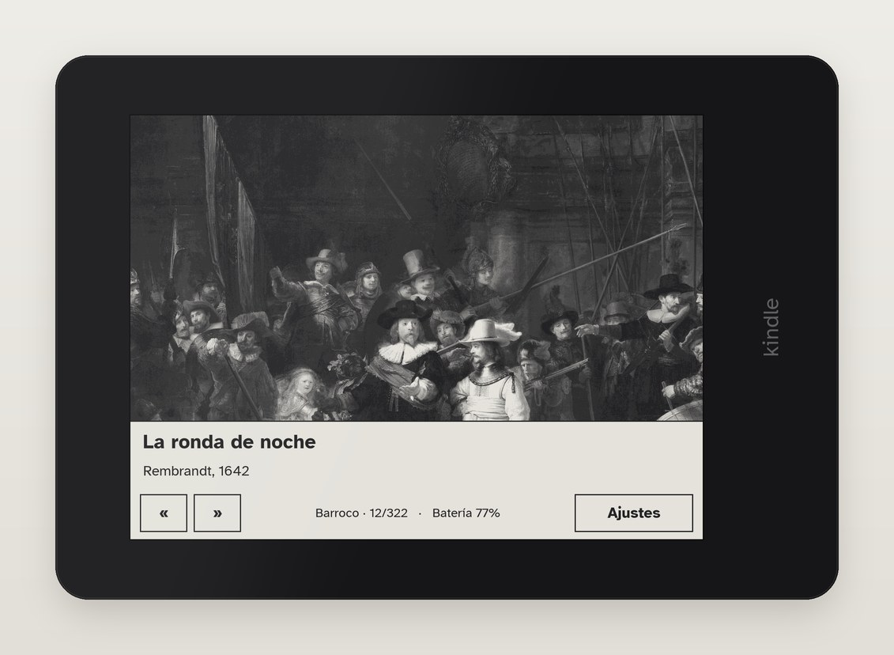
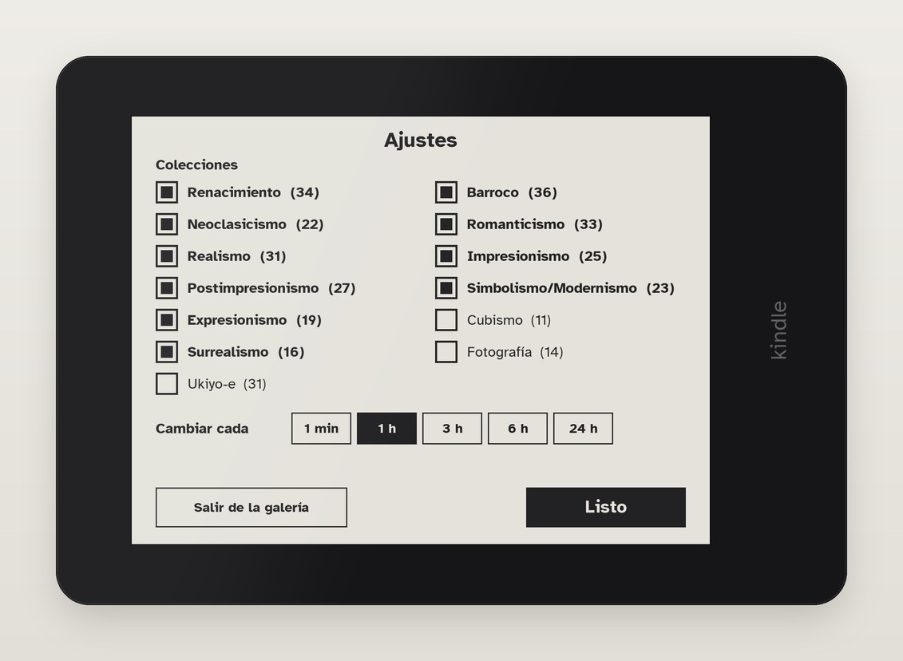
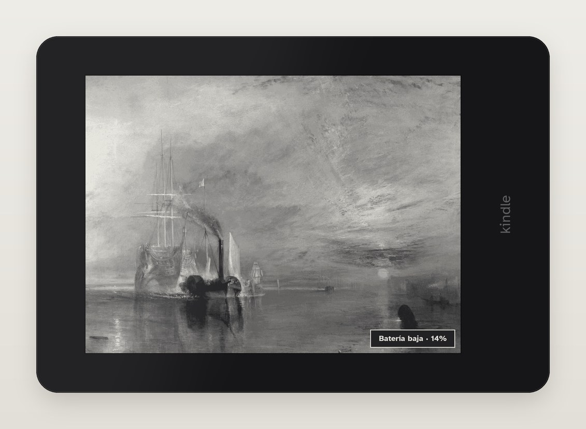
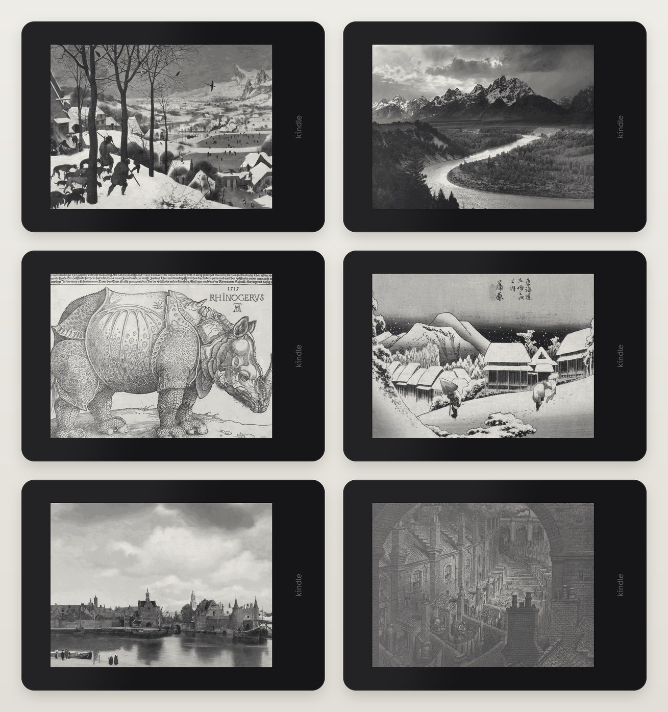

# Kindle art gallery

Turns a jailbroken Kindle Paperwhite 4 into an e-ink art frame. It shows famous artworks
full screen in landscape, grouped by art movement, and changes them on a schedule. In
between it sleeps, so a charge lasts about three weeks. It runs fully offline and starts
by itself when the Kindle boots.



The repo comes with 297 works in 6 collections: old masters, modern painting, prints
and drawings, two of black-and-white photography, and ukiyo-e. They were
chosen by a blind panel from 739 candidates, judged as they look in the screen's 16 greys.
You can curate your own: the build pipeline downloads the originals, renders the panels
and scores how well each one survives on e-ink.

## What it looks like

A press of the power button opens a card with what is on screen: title, artist and
date, the collection and the battery, with buttons for the previous and next work.
Swipes change the work too; after 30 seconds without touches it goes back to sleep.



Everything else is one level down, in **Ajustes**: the collections (the gallery shuffles the ticked ones and shows every work once before
reshuffling), how often the work changes, and the way out, which asks first. The gallery
is meant to be left running; leaving it by accident should be hard.



When the battery drops to 15% a small badge appears over the painting, and near empty a
"please charge" screen replaces it, so the frame never dies on a normal-looking picture.





The interface and the included collections are in Spanish.

## How it works

The gallery (`art/artd.lua`, Lua 5.1, the Kindle's own interpreter) pauses the Kindle's
UI instead of stopping it, takes over the touchscreen and power button through a small C
helper (`art/evtap`), and draws with FBInk. Between changes it suspends the Kindle to
RAM with an RTC alarm and the frontlight off, which brings the average draw down to
about 2.9 mA. Leaving the gallery resumes the Kindle UI instantly.

Content is built on a computer and copied to the Kindle. Updating it never involves the
gallery, which has no network code at all:

```
 computer                          GitHub                     Kindle
 --------                          ------                     ------
 content/works/*.json  (curation)
 content/build.py ──> panels ──>   content/catalog.tsv  ──>   "Actualizar galería" (library)
                      catalogue    content/panels/...         downloads what changed,
                                                              checks sha256, swaps it in
 tools/deploy.py  ─── SSH ──────────────────────────────────> app, library items, content
                                                              gallery: reads content/ offline
```

The catalogue is a TSV file with one line per work (file, sha256, title, artist, date),
which the device reads without a JSON parser. More in
[docs/architecture.md](docs/architecture.md).

## Docs

- [docs/setup.md](docs/setup.md): installing on your Kindle, using it, configuration,
  leaving it set up for someone else.
- [docs/content.md](docs/content.md): curating collections and building panels.
- [docs/architecture.md](docs/architecture.md): the content format and the sync.
- [docs/development.md](docs/development.md): device internals, tests, deploy, and
  the traps already found.

## Repo layout

```
art/        the gallery: artd.lua, gallery.sh, ui.sh, start/stop scripts, artsync.sh,
            evtap/ (input helper), doc/ (library items), sim/ (desktop tests),
            dev/ (device probes), assets/fonts/
content/    collections.tsv, works/ (curation), build.py, originals/, panels/,
            catalog.tsv
docs/       documentation and the README pictures
tools/      deploy.py, kexec.py, fontwidths.py, screenshots.py
```

The artworks come from Wikimedia Commons, the Art Institute of Chicago and WikiArt.
Some are still under copyright; they are included for personal, non-commercial use.
