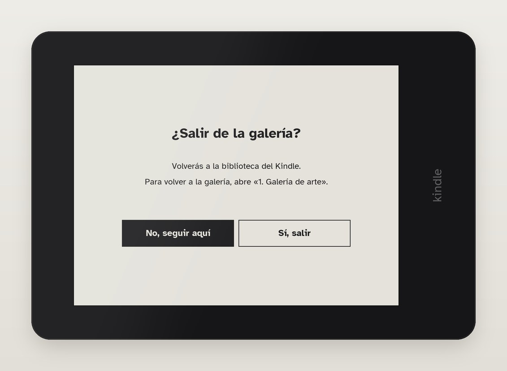

# Setup

## What you need

A Kindle Paperwhite 4 (10th generation), jailbroken. It was built and tested on
firmware 5.18.1 jailbroken with SpiderCat, plus the usual tools on top: FBInk at
`/mnt/us/libkh/bin/fbink`, an SSH server (dropbear) in `/mnt/us/jobman`, and the
jailbreak's boot hook that runs `/mnt/us/emergency.sh`. Other setups need those paths
adjusted (`FBINK` in the scripts, `art/doc/Enable-SSH.sh`). Lua 5.1 is already on the Kindle. The Kindle
does not need to be registered with Amazon.

On the computer: Python 3 and [uv](https://docs.astral.sh/uv/) (the tools run with
`uv run --with ...`, so there is nothing else to install).

## Install

1. Get SSH working. Connect the Kindle by USB, copy `art/doc/Enable-SSH.sh` into its
   `documents/` folder, eject, and open **"9. Enable SSH (Wi-Fi)"** in the library. It
   starts dropbear (user `root`, password `kindle`) and opens port 22 in the firewall.
   Both reset on every restart.
2. Find the Kindle's IP address (your router lists it) and install everything:

   ```
   export KINDLE_HOST=<the Kindle's IP>
   uv run --with paramiko python tools/deploy.py --content --fonts --admin
   ```

3. In the library, open **"1. Galería de arte"**.

`--admin` also puts the two admin items in the library (SSH and autostart); without it,
`deploy.py` leaves only the two everyday items and keeps the admin ones in
`/mnt/us/art/admin/`. `deploy.py` never overwrites the config or the gallery's state,
and `--content` only sends panels that changed.

The library shows "El Cloud no está disponible" on an unregistered Kindle unless its
filter is set to *Descargado* (downloaded).

## Using it

The artwork fills the screen and changes every hour. Between changes the Kindle is
asleep, so touch does nothing: press the power button briefly to wake it, which opens
the card at the bottom with the title, artist, date, collection and battery, and three
buttons: previous, next and **Ajustes**. While awake, swipe left or right to change the
work, and tap above the card to close it. The power button with the card open closes it
and sleeps at once; otherwise it sleeps after 30 s without touches.

**Ajustes** has the collections (one checkbox each; at least one stays on), how often
the work changes (1 min, 1 h, 3 h, 6 h, 24 h), **Listo**, and **Salir de la galería**,
which asks "¿Salir de la galería?" before returning to the Kindle library. Ajustes and
the question close by themselves after a minute. Holding two fingers on the screen for
2 s also exits, from anywhere: a failsafe for development.



Library items:

| Item | What it does |
| --- | --- |
| 1. Galería de arte | starts the gallery |
| 2. Actualizar galería | downloads new or changed works from GitHub (Wi-Fi) |
| 3. Autostart on/off | admin: start the gallery at boot or not (on by default) |
| 9. Enable SSH (Wi-Fi) | admin: SSH until the next restart |

"Actualizar galería" only runs from the library, with the gallery stopped. It turns
Wi-Fi on if needed, downloads only what changed, checks every file against the
catalogue, and shows the result at the bottom of the screen. If anything fails, the
current content stays as it was.

## Configuration

`/mnt/us/art/config`, one `KEY=value` per line:

| Key | Default | Meaning |
| --- | --- | --- |
| `INTERVAL` | 3600 | seconds between changes (the bar's interval button sets it) |
| `OFF` | | unticked collections, comma separated (the collections screen sets it) |
| `SLEEP` | 1 | 1 suspends between changes, 0 stays awake |
| `AWAKE` | 30 | idle seconds before sleeping |
| `WIFI` | 0 | 0 turns Wi-Fi off while the gallery runs |
| `ROT` | 0 | landscape framebuffer rotation, found automatically |
| `REPO` | `ichinaski/kindle-art-gallery` | GitHub repo "Actualizar galería" syncs from |

To show your own collections, fork this repo, curate them (see
[content.md](content.md)), push, and set `REPO=<you>/<your fork>`. The repo must be
public: the Kindle downloads from it without a token.

## Leaving it for someone else

1. Save their home Wi-Fi on the Kindle (in the Kindle's own settings, after leaving the
   gallery), then turn airplane mode on. On a Wi-Fi-only Kindle airplane mode is the
   same radio switch the gallery uses, so the radio stays off everywhere, also in the
   library. The gallery leaves it as it found it, and "Actualizar galería" turns it on
   only for the update and back off after.
2. Leave autostart on, so the gallery comes back by itself after a restart or an empty
   battery.
3. Run a last `deploy.py` without `--admin`, so the library only shows the two everyday
   items. SSH stops at the next restart and is never started at boot.
4. Keep Amazon's firmware updates blocked: an update would undo the jailbreak. The
   jailbreak used here already disables the updater (`otaupd` renamed), and `deploy.py`
   also creates the folder `/mnt/us/update.bin.tmp.partial`, which stops update
   downloads.
5. Hand it over charged, with the gallery running.

Later maintenance: connect it by USB and copy `art/admin/Enable-SSH.sh` into
`documents/` to get SSH back.

## Where things live on the Kindle

```
/mnt/us/emergency.sh          boot hook (autostart)
/mnt/us/art/
  artd.lua gallery.sh ui.sh start-art.sh stop-art.sh artsync.sh widths.lua bin/ fonts/
  admin/                      admin library items, out of the library
  config state rotation       settings and the shuffle position
  no-autostart                optional: disables autostart
  content/                    catalog.tsv collections.tsv images/<collection>/<id>.png
  content-version sync.log    last sync
  artd.log gallery.log        logs, copied from /tmp when the gallery stops
/mnt/us/documents/*.sh        library items (sources in art/doc/)
/mnt/us/update.bin.tmp.partial  blocks firmware updates
/tmp/art-run/                 RAM copy of the program while it runs
```

Deregistering the Kindle empties `/mnt/us/documents` but leaves `/mnt/us/art`; reinstall
the library items with `deploy.py`. To remove everything, delete `/mnt/us/art`,
`/mnt/us/emergency.sh` and the library items. No system files are changed.
